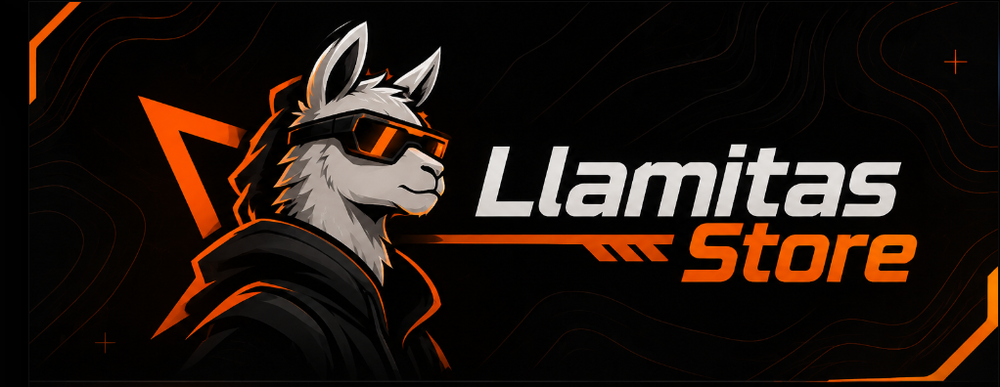
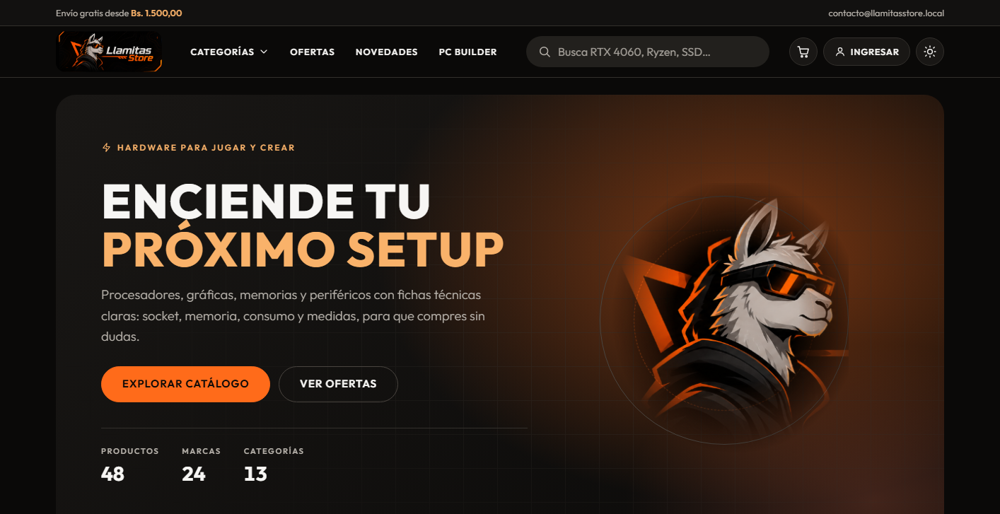
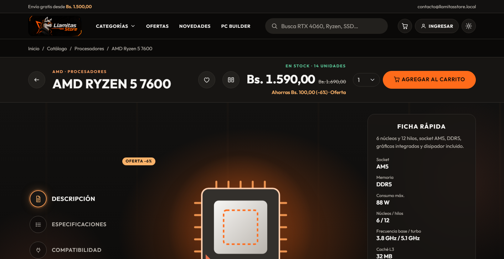
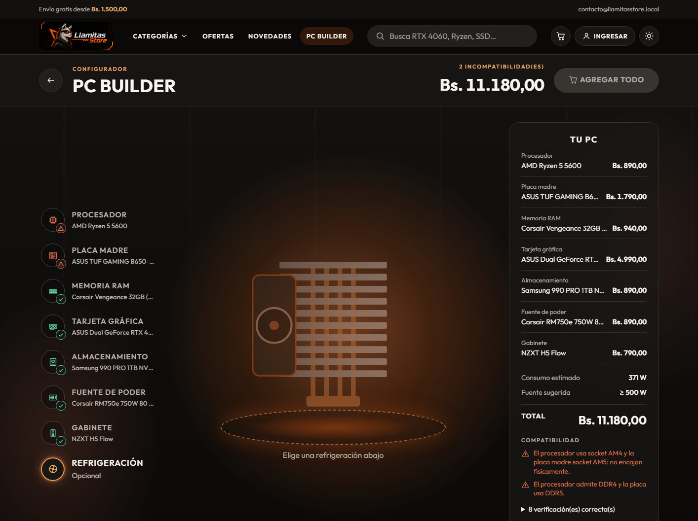
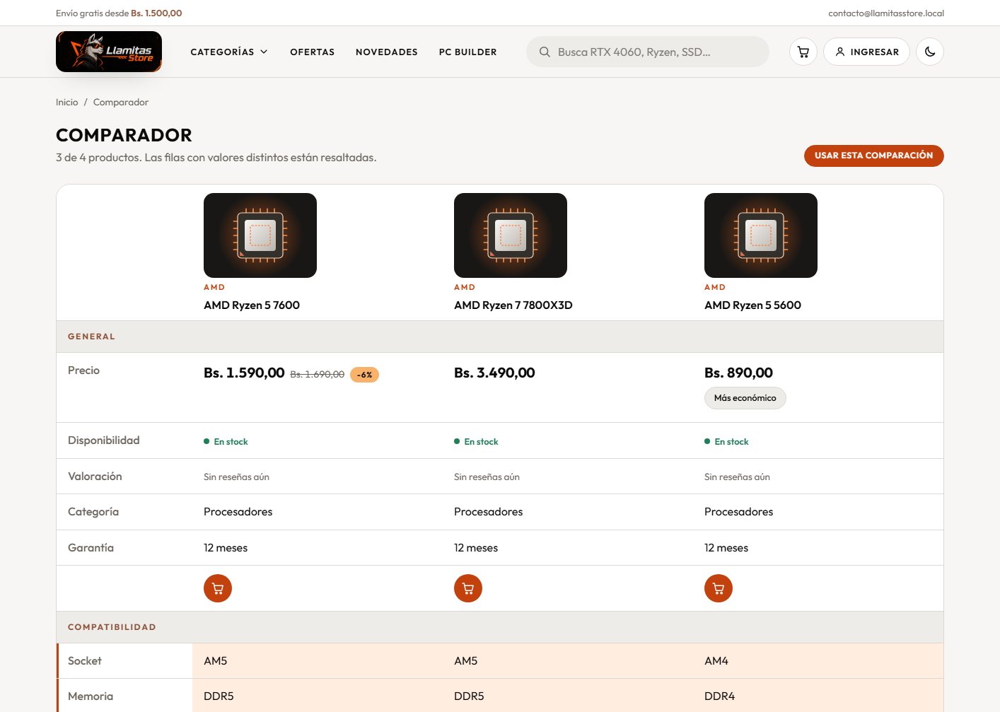
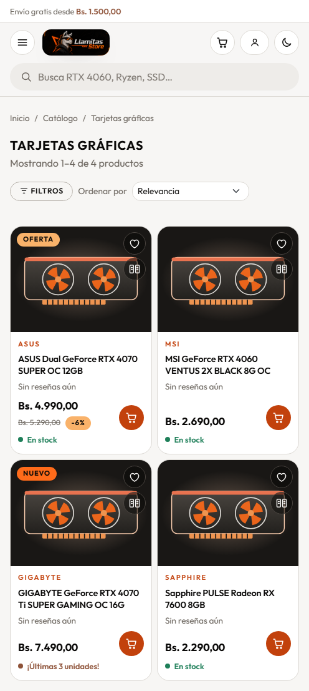

<p align="center">
  
</p>

<p align="center">
  Tienda online de componentes de PC, hardware y periféricos gaming, con PC Builder que verifica compatibilidad,
  comparador, reseñas y panel administrativo con permisos por módulo.
</p>

<p align="center">
  ASP.NET Core MVC (.NET 10) · EF Core 9 · MariaDB / MySQL · Bootstrap 5 · 236 pruebas automatizadas
</p>

---

## Contenido

- [Capturas](#capturas)
- [Funcionalidades](#funcionalidades)
- [Tecnologías](#tecnologías)
- [Puesta en marcha](#puesta-en-marcha)
- [Configuración](#configuración)
- [Pruebas](#pruebas)
- [Arquitectura](#arquitectura)
- [Seguridad](#seguridad)
- [Sistema de diseño](#sistema-de-diseño)
- [Paso a producción](#paso-a-producción)
- [Limitaciones conocidas](#limitaciones-conocidas)

## Capturas

| Inicio | Ficha de producto |
| :---: | :---: |
|  |  |
| **PC Builder (detectando incompatibilidades)** | **Comparador** |
|  |  |

<p align="center"></p>

## Funcionalidades

### Tienda
- **Catálogo** con filtros por categoría, marca, precio, socket, tipo de memoria, valoración, disponibilidad y ofertas; orden y paginación.
- **Buscador** con sugerencias mientras escribes (categorías y productos, con límite de peticiones).
- **Ficha de producto** tipo configurador: descripción, especificaciones agrupadas, datos de compatibilidad explicados, reseñas y alternativas con la diferencia de precio.
- **Precios** con ofertas por producto y promociones por marca o categoría; siempre se aplica el mejor descuento vigente.
- **Comparador** de hasta 4 productos, con las diferencias resaltadas y un enlace para compartir.
- **Tema claro y oscuro**, diseño adaptable a móvil.

### PC Builder (`/pc-builder`)
- Armado paso a paso: procesador, placa, RAM, gráfica, almacenamiento, fuente, gabinete y refrigeración.
- **Reglas de compatibilidad verificables**, calculadas con los datos técnicos de cada ficha:
  - socket CPU–placa
  - tipo de memoria (placa, RAM y CPU)
  - ranuras y capacidad máxima de RAM
  - ranuras M.2 y puertos SATA
  - formato placa–gabinete
  - largo de la GPU
  - altura y montaje del disipador
  - disipador incluido y gráficos integrados
  - consumo estimado y fuente sugerida
- Cada incompatibilidad se explica con los valores concretos. Si falta un dato, el resultado es **«sin verificar»**, nunca «compatible».
- Opción sugerida y diferencia de precio en cada paso; el armado completo se agrega al carrito con un clic.
- La selección viaja en la URL (se puede compartir); con cuenta se guardan hasta 20 armados.

### Cuenta del cliente
- Registro e inicio de sesión con correo o con **Google** (opcional), recuperación de contraseña por correo.
- Perfil, libreta de direcciones (departamentos de Bolivia), favoritos, «Mis PCs», pedidos y **notificaciones** de cambios de estado.
- **Reseñas**: una por producto (se puede editar). La etiqueta «Compra verificada» la calcula el servidor a partir de un pedido entregado.

### Carrito y checkout
- Carrito persistente; el de visitante se une al de la cuenta al ingresar.
- Cupones con vigencia, monto mínimo y límites de uso; envío gratis desde un monto configurable.
- Pago **contra entrega** o **transferencia bancaria** (el administrador confirma el pago). No se piden ni guardan datos de tarjeta.
- El stock se descuenta de forma atómica dentro de una transacción y se devuelve al cancelar.

### Panel administrativo (`/admin`)
- Dashboard con ventas por día, productos más vendidos, stock bajo y pedidos recientes.
- Productos (imágenes, especificaciones y compatibilidad), categorías, marcas, inventario con movimientos, proveedores y órdenes de compra.
- Pedidos (cambio de estado con historial, confirmación de pago), usuarios y roles, promociones y cupones, moderación de reseñas, mensajes de contacto y configuración de la tienda.
- **Permisos por rol y módulo** (leer / crear / editar / eliminar), verificados en el servidor en cada acción.

### Información y SEO
- Contacto (con protección anti-bots), preguntas frecuentes y políticas de envíos, garantía y devoluciones, términos y privacidad. Los montos se toman de la configuración de la tienda.
- `robots.txt`, `sitemap.xml` con el catálogo activo, Open Graph, URL canónica y datos estructurados `schema.org/Product`.

## Tecnologías

| Área | Tecnología |
| :--- | :--- |
| Backend | ASP.NET Core MVC sobre **.NET 10**, ASP.NET Core Identity (claves `int`) |
| Datos | **Entity Framework Core 9** + Pomelo.EntityFrameworkCore.MySql 9 · MySqlConnector 2.6.2 |
| Base de datos | **MariaDB 10.11** (XAMPP) o MySQL 8 |
| Frontend | Vistas Razor, Bootstrap 5, JavaScript sin frameworks (mejora progresiva: todo funciona sin JS) |
| Tipografía | Outfit (alojada en el sitio, licencia OFL) |
| Pruebas | xUnit, SQLite en memoria, `Microsoft.AspNetCore.Mvc.Testing` |

## Puesta en marcha

### Requisitos
- [.NET SDK 10](https://dotnet.microsoft.com/download)
- MariaDB o MySQL en `localhost:3306` (por ejemplo **XAMPP** con MySQL iniciado)
- Opcional: DBeaver u otro cliente para ver la base

### 1. Clonar y restaurar
```bash
git clone https://github.com/whitdariel/LlamitasStore.git
cd LlamitasStore
dotnet tool restore     # instala dotnet-ef 9 (local al repositorio)
```

### 2. Base de datos
`appsettings.Development.json` usa la configuración por defecto de XAMPP (`root` sin contraseña):

```
Server=127.0.0.1;Port=3306;Database=llamitasstore;User=root;Password=;
```

Si tu MySQL tiene contraseña, no edites el archivo versionado: usa *user-secrets*.

```bash
dotnet user-secrets set "ConnectionStrings:DefaultConnection" "Server=127.0.0.1;Port=3306;Database=llamitasstore;User=root;Password=TU_CLAVE;" --project src/LlamitasStore
```

En Desarrollo la base **se crea y migra sola** al arrancar (`Database:MigrarAlIniciar`), y se cargan datos de demostración (`Seed:DatosDemo`): 48 productos, 24 marcas, 13 categorías, cupones `BIENVENIDA10` y `SETUP50`, y tres usuarios.

### 3. Usuarios de demostración (opcional, antes del primer arranque)

| Usuario | Rol |
| :--- | :--- |
| `admin@llamitasstore.local` | Administrador |
| `vendedor@llamitasstore.local` | Vendedor |
| `cliente@llamitasstore.local` | Cliente |

Las contraseñas **no están en el código**. Puedes fijarlas antes del primer arranque:

```bash
dotnet user-secrets set "Seed:PasswordAdmin" "UnaClaveSegura1" --project src/LlamitasStore
dotnet user-secrets set "Seed:PasswordVendedor" "UnaClaveSegura2" --project src/LlamitasStore
dotnet user-secrets set "Seed:PasswordCliente" "UnaClaveSegura3" --project src/LlamitasStore
```

Si no las fijas, se genera una contraseña aleatoria y se muestra **una sola vez** en la consola del primer arranque.

**¿Perdiste la contraseña?** En Desarrollo, sin SMTP configurado, los correos se guardan como `.html` en `src/LlamitasStore/App_Data/correos/`:
1. Entra a `/cuenta/olvide-contrasena` con el correo del usuario.
2. Abre el `.html` más reciente de esa carpeta.
3. Sigue el enlace para elegir una contraseña nueva.

### 4. Ejecutar
```bash
dotnet run --project src/LlamitasStore --launch-profile http
```
Abre **http://localhost:5181**. El panel administrativo está en **http://localhost:5181/admin**.

> El perfil `https` (`https://localhost:7226`) necesita el certificado de desarrollo de confianza: `dotnet dev-certs https --trust`.

### Editar el catálogo
Con un usuario **Administrador**, en `/admin`:

| Quiero… | Dónde |
| :--- | :--- |
| Crear un producto | **Productos → Nuevo producto**: datos, precio, stock inicial, especificaciones (`Grupo \| Nombre \| Valor`, una por línea) y compatibilidad para el PC Builder |
| Cambiar precio, oferta, descripción o datos técnicos | **Productos → Editar** (cada cambio de precio queda en el historial) |
| Subir fotos | **Productos → Editar → Imágenes** (JPG, PNG o WebP, máx. 2 MB y 8 por producto; elige cuál es la principal) |
| Cambiar el stock | **Inventario → Ajustar** (entrada, salida o conteo; queda registrado cada movimiento) |
| Ocultar un producto | **Dar de baja** (desaparece de la tienda; los pedidos antiguos lo conservan) |
| Categorías y marcas | **Categorías** y **Marcas** (orden en el menú, ícono, tipo de componente para el PC Builder, visible/oculta) |
| Ofertas por marca o categoría y cupones | **Promociones** |

El rol **Vendedor** puede ver productos y manejar inventario y pedidos, pero no crear productos ni cambiar categorías; los permisos de cada rol se ajustan en **Usuarios → Roles**.

### Aplicar migraciones a mano (opcional)
```bash
dotnet ef database update --project src/LlamitasStore
```
Las migraciones están en `src/LlamitasStore/Data/Migraciones`.

## Configuración

Todas las claves se pueden definir con *user-secrets* (desarrollo) o con variables de entorno (producción, usando `__` en lugar de `:`, por ejemplo `ConnectionStrings__DefaultConnection`).

| Clave | Para qué |
| :--- | :--- |
| `ConnectionStrings:DefaultConnection` | Cadena de conexión MySQL/MariaDB (**obligatoria**) |
| `Database:ServerVersion` | Versión del servidor (por defecto `10.11.19-mariadb`; para MySQL, p. ej. `8.0.36-mysql`) |
| `Database:MigrarAlIniciar` | Aplica migraciones y datos base al arrancar |
| `Seed:DatosDemo` | Carga catálogo y usuarios de demostración |
| `Seed:PasswordAdmin` / `PasswordVendedor` / `PasswordCliente` | Contraseñas de los usuarios demo |
| `Authentication:Google:ClientId` / `ClientSecret` | Activa el botón «Continuar con Google» (si faltan, el botón no aparece) |
| `Correo:Smtp:Host`, `Puerto`, `Usuario`, `Password`, `UsarSsl` | Envío real de correos; sin `Host`, en Desarrollo se guardan en `App_Data/correos` |
| `Correo:Remitente`, `Correo:NombreRemitente` | Remitente de los correos |
| `Limites:FormulariosPorMinuto` / `BusquedasPorMinuto` | Límites por IP (por defecto 10 y 90) |

**Google:** crea credenciales OAuth «Aplicación web» en Google Cloud Console con el URI de redirección `http://localhost:5181/signin-google` (y el de tu dominio en producción).

Los datos de la tienda (nombre, correo, teléfono, dirección, costo de envío, envío gratis e instrucciones de transferencia) se editan en **Panel → Configuración**.

## Pruebas

```bash
dotnet test
```

| Área | Pruebas | Qué cubre |
| :--- | ---: | :--- |
| Base | 25 | Modelo de datos, índices, restricciones CHECK, datos iniciales |
| Catálogo | 44 | Filtros, orden, precios y promociones, ficha, sugerencias |
| Cuentas | 31 | Registro, login, recuperación, perfil, direcciones, favoritos, cabeceras de seguridad |
| Ventas | 29 | Totales, cupones, carrito, pedidos, stock transaccional, compra completa por HTTP |
| Admin | 20 | Permisos por módulo, servicios del panel, accesos denegados |
| PC Builder | 38 | Cada regla (correcto / error / sin dato), selección por URL, armados guardados |
| Comunidad | 43 | Reseñas, notificaciones, comparador, contacto, SEO y **accesibilidad básica** |
| Diseño | 6 | Paleta única, tipografía única, sin estilos ni scripts en línea (CSP) |

Las pruebas HTTP levantan la aplicación real (`Program.cs` completo) sobre SQLite en memoria, con cookies, antiforgery y redirecciones como un navegador.

## Arquitectura

```
LlamitasStore.sln
├── src/LlamitasStore
│   ├── Controllers/        Tienda: catálogo, carrito, checkout, cuenta, PC Builder, comparador, contacto, SEO
│   ├── Areas/Admin/        Panel administrativo (controladores, vistas y formularios)
│   ├── Services/           Lógica de negocio (Catalogo, Ventas, Cuentas, PcBuilder, Comunidad, Admin, Correo)
│   ├── Data/               AppDbContext, transacciones con reintentos, migraciones y datos iniciales
│   ├── Models/Entities/    Entidades de dominio
│   ├── ViewModels/         Modelos de vista y formularios con validación
│   ├── Infraestructura/    Permisos, cabeceras de seguridad, Identity en español, límites
│   ├── Views/              Vistas Razor
│   └── wwwroot/            CSS (sistema de diseño), JS, íconos SVG, imágenes y marca
├── tests/LlamitasStore.Tests
└── docs/                   Capturas y script SQL del proyecto original (referencia)
```

Decisiones principales:
- **Los controladores son delgados**: la lógica vive en servicios que se prueban sin HTTP.
- **Una sola fórmula de totales** (`CalculadoraTotales`) para carrito, checkout y pedido.
- **Operaciones críticas en transacción** con la estrategia de reintentos de MySQL. El stock se actualiza con `UPDATE … WHERE stock >= cantidad`, así no se sobrevende con compras simultáneas.
- **Base de datos en `snake_case`**; los enums se guardan como texto y las reglas de negocio también se aplican con restricciones `CHECK`.

## Seguridad

- **Contraseñas:** con el hash de ASP.NET Core Identity (PBKDF2), nunca en texto plano. Bloqueo tras intentos fallidos y política de contraseñas en español.
- **Credenciales:** ninguna en el código. Se configuran con *user-secrets* o variables de entorno.
- **Formularios:** token **CSRF** global en todo POST y **límite de peticiones** en login, registro, recuperación, contacto, reseñas y buscador.
- **Cabeceras de seguridad:** **CSP estricta** (sin scripts ni estilos en línea; una prueba lo verifica), `X-Content-Type-Options`, `Referrer-Policy`, `Permissions-Policy` y `X-Frame-Options`.
- **Cookies:** `HttpOnly`, `SameSite=Lax` y `Secure` en producción.
- **Permisos del panel:** se comprueban **en el servidor** por rol y módulo. Los datos del cliente (pedidos, direcciones, armados, notificaciones, reseñas) se filtran siempre por el usuario de la sesión, nunca por un id enviado por el navegador.
- **Redirecciones:** solo locales (`returnUrl`, notificaciones).
- **Pagos:** no se almacenan datos de tarjetas ni bancarios de clientes.
- **Dependencias:** sin paquetes vulnerables según `dotnet list package --vulnerable`. MySqlConnector está fijado en 2.6.2 por el aviso GHSA-473q-m89c-ghf8.

## Sistema de diseño

- **Una paleta**, «Llamitas Fuego», tomada del logo: neutros negros, naranja principal, ámbar de acento y menta solo para estados positivos. Está definida una sola vez en `wwwroot/css/llamitas.css` y una prueba falla si aparece un color fuera de ella.
- **Una tipografía**, Outfit.
- Los contrastes de texto sobre el color principal están calculados para cada tema: blanco sobre naranja oscuro en claro, negro sobre naranja vivo en oscuro.
- Marca en `wwwroot/images/marca/`: logo principal, logotipo, favicon e ícono para iOS.

## Paso a producción

1. `ASPNETCORE_ENVIRONMENT=Production` (cookies solo HTTPS, HSTS y página de error genérica).
2. Define `ConnectionStrings__DefaultConnection` con un usuario de base de datos **propio**, no `root`.
3. Aplica las migraciones (`dotnet ef database update` o `Database__MigrarAlIniciar=true` en el primer despliegue) y deja `Seed__DatosDemo=false`.
4. Configura SMTP (`Correo__Smtp__Host`…); sin SMTP, en producción los correos no se envían y cada intento queda registrado como error en el log.
5. Revisa en el panel los datos de la tienda y las instrucciones de transferencia.
6. Revisa los textos de **Términos**, **Garantía y devoluciones** y **Privacidad** (`Views/Info/`): describen cómo funciona el sistema, pero no son asesoría legal.

## Limitaciones conocidas

- **Sin pasarela de pagos en línea:** solo contra entrega y transferencia con confirmación manual. Para cobrar con tarjeta habría que integrar un proveedor certificado.
- **Plazos de envío:** no se modelan por departamento; se informan al preparar el pedido.
- **EF Core 9:** se mantiene en 9 porque Pomelo (proveedor MySQL) todavía no tiene versión para EF Core 10/11.
- **Ilustraciones de productos:** las imágenes del catálogo demo son ilustraciones SVG genéricas por categoría; en producción se suben fotos reales desde el panel.
